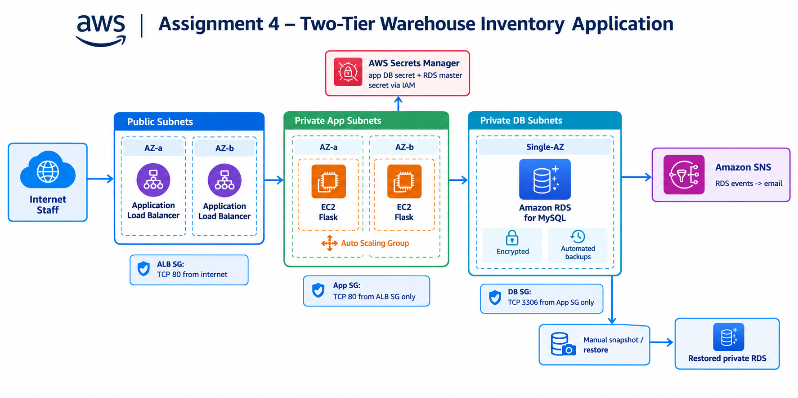

# Architecture diagram

`architecture.png` is the existing conceptual architecture diagram supplied with the project files. It is not a screenshot or an audit of the deployed AWS account.

Interpretation:

* The two ALB icons represent the Availability-Zone footprint of one ALB, not two separately managed load balancers.
* EC2 application instances use shared RDS data.
* RDS is Single-AZ in the reviewed source, although its DB subnet group spans two private DB subnets.
* SNS email requires an actual configured and confirmed subscription.
* Snapshot/restore is a proposed/required recovery workflow, not proof that recovery has been completed.
* NAT egress, GitHub retrieval, exact route-table details, port settings and IAM policies are not fully drawn. Refer to Terraform source for them.

The diagram contains no real account IDs, private endpoints, or credentials.
